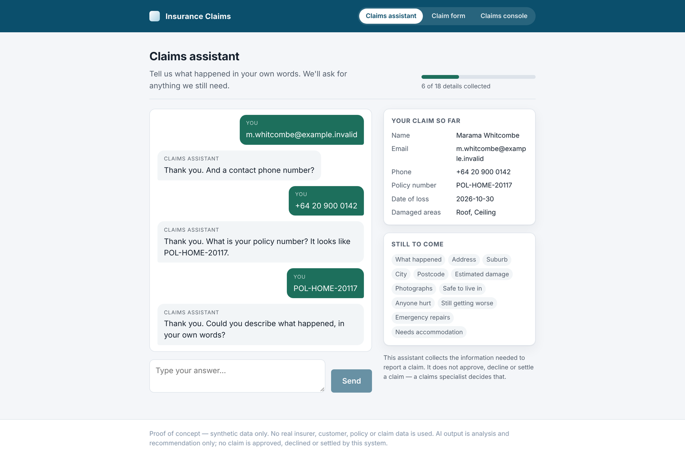
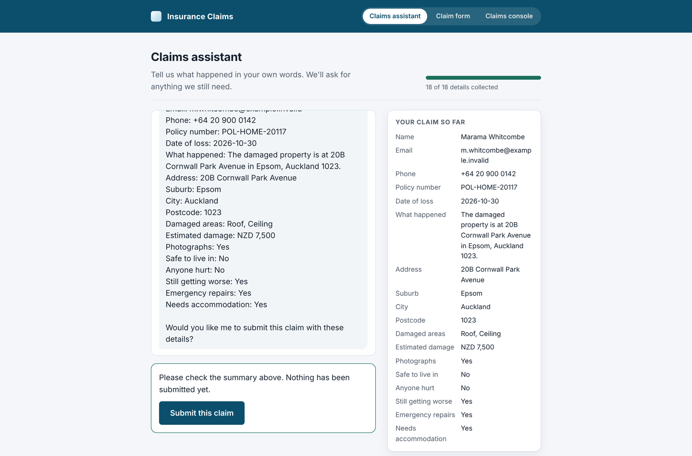
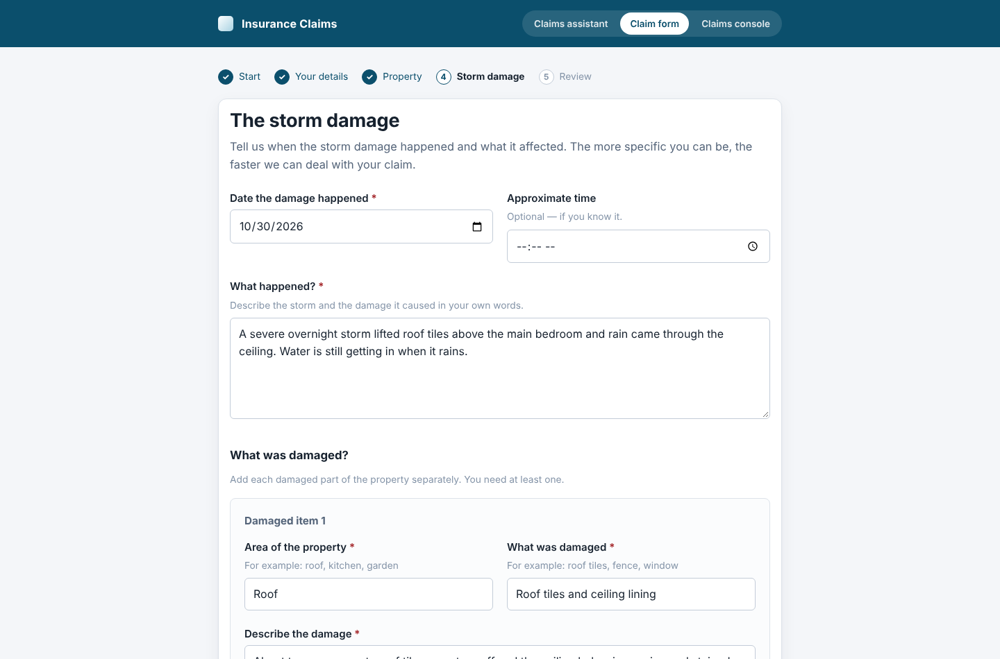
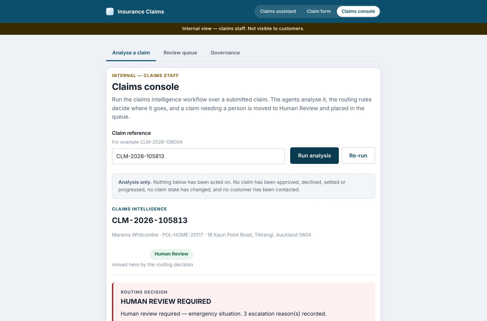
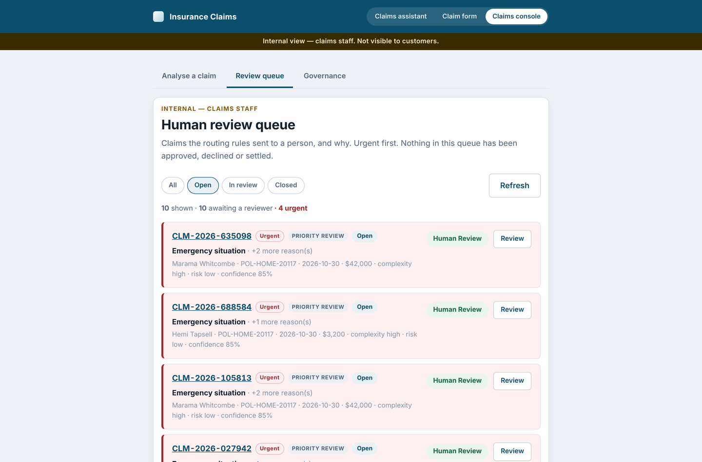
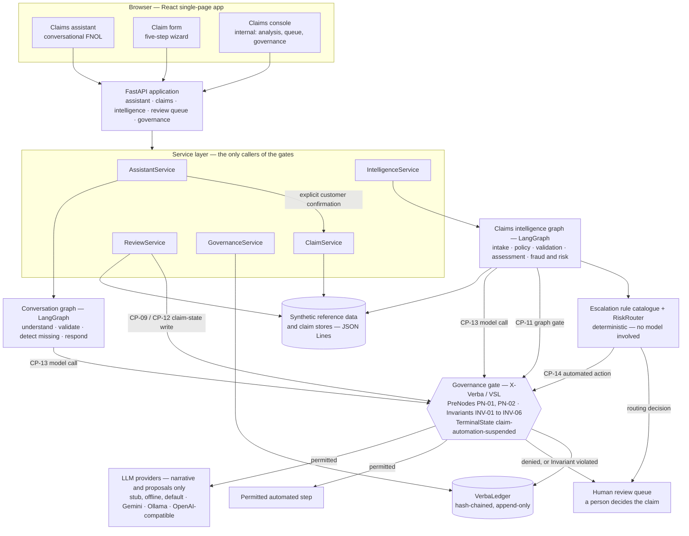
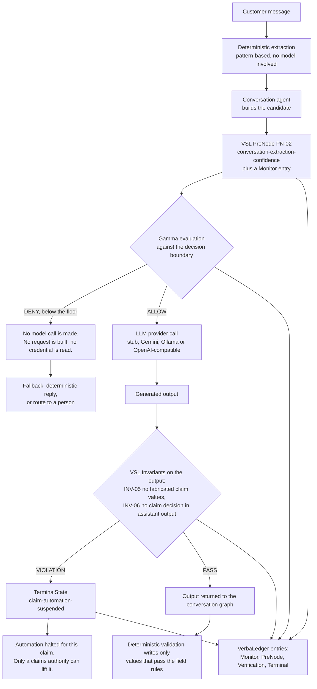

# AI-Powered Insurance Claims Agent

A working proof of concept for **governed AI in insurance claims handling**.

A customer describes storm damage to their home in their own words. A team of specialist AI
agents reads the claim, retrieves the policy, checks what is missing, assesses complexity and
value, and flags risk indicators. Business rules then decide where the claim should go. Before
any of that becomes an *action* — a claim-state change, a queue placement, even a call out to a
language model — a governance layer decides whether the system is permitted to proceed.

The point of the project is that last sentence. Plenty of systems can produce an AI claims
recommendation. This one is built so that every consequential step is checked *before* it
happens, and so that what was checked, what was decided, and why is written to a tamper-evident
record that can be audited afterwards.

> **Synthetic data only.** No real customer, policy or claim data is used anywhere in this
> repository.
>
> **The AI produces analysis and recommendations. It does not approve, decline or settle
> claims.** A person does.
>
> **Governance decides whether an automated step may run. It does not decide the claim.** These
> are different questions, and the system keeps them apart deliberately.

---

## Contents

| | |
| --- | --- |
| [1. Project status](#1-project-status) | [11. Prerequisites](#11-prerequisites) |
| [2. What this does, in plain terms](#2-what-this-does-in-plain-terms) | [12. Installation](#12-installation) |
| [3. Key capabilities](#3-key-capabilities) | [13. Configuration](#13-configuration) |
| [4. Screenshots](#4-screenshots) | [14. Running the tests](#14-running-the-tests) |
| [5. Architecture](#5-architecture) | [15. Example scenario](#15-example-scenario) |
| [6. End-to-end workflow](#6-end-to-end-workflow) | [16. Limitations and security](#16-limitations-and-security) |
| [7. AI and governance](#7-ai-and-governance) | [17. Roadmap](#17-roadmap) |
| [8. Technology stack](#8-technology-stack) | [18. Contributing and licence](#18-contributing-and-licence) |
| [9. Project structure](#9-project-structure) | [19. Summary](#19-summary) |
| [10. Documentation](#10-documentation) | |

---

## 1. Project status

**This is a proof of concept. It is not production software and should not be described as
production-ready.**

It runs, it is covered by 517 automated tests, and the governance enforcement is structural
rather than decorative. What it does not have is everything an insurer would require before
putting it anywhere near a customer: there is no authentication, no authorisation, no database,
no deployment pipeline, no monitoring, and no security review.
[Section 16](#16-limitations-and-security) lists these explicitly rather than burying them.

**What is implemented and demonstrable today**

| Area | State |
| --- | --- |
| Conversational claims assistant | Implemented — collects 18 claim details from free-text messages |
| Structured claim form | Implemented — five-step guided alternative to the conversation |
| Claims intelligence workflow | Implemented — five specialist agents orchestrated with LangGraph |
| Business routing and escalation | Implemented — rule-based, with cited reasons |
| Human review queue | Implemented — queue, claim review screen, recorded reviewer actions |
| X-Verba / VSL governance enforcement | Implemented at four commitment points |
| VerbaLedger and audit tooling | Implemented — hash-chained record, CLI, dashboard |
| Authentication and authorisation | **Not implemented** |
| Persistent database | **Not implemented** — JSON Lines files on disk |
| Document upload and processing | **Not implemented** |
| Outbound customer communication | **Not implemented** — nothing is ever sent to anyone |

There are no build badges in this README because there is no CI pipeline to report on, and a
badge for a pipeline that does not exist is a lie that looks like a fact.

---

## 2. What this does, in plain terms

*This section assumes no background in AI or software engineering.*

### The situation

A storm hits overnight. Tiles come off a roof, water gets into a ceiling, and the next morning a
homeowner needs to tell their insurer what happened. That first report is called a **FNOL** —
First Notice of Loss. It is the moment a claim begins.

Most of those reports are straightforward. Some are not: the home might be unsafe to live in, the
damage might still be getting worse, the amount might be large, or the policy might not clearly
cover what happened. Insurers want the straightforward ones handled quickly, and the difficult
ones in front of an experienced person quickly. Sorting one from the other, reliably and
consistently, is the work.

### What the system does

A customer opens the claims assistant and types something like:

> *"A storm last night tore tiles off the roof above our bedroom and the ceiling has come down.
> The house isn't safe to live in and water's still coming in."*

From there:

1. **It understands the message.** The system pulls out structured details — what was damaged,
   when, where, how much, whether anyone was hurt, whether the home is habitable — and asks
   follow-up questions for anything still missing. It shows the customer exactly what it has
   recorded, so nothing is captured silently.

2. **It checks everything before submitting.** Nothing becomes a claim until the customer reads a
   plain summary and presses a button. The assistant cannot decide on its own that the customer
   said yes.

3. **Specialist agents analyse the claim.** Five of them, each with one job: read and structure
   the report, retrieve and interpret the policy, check for missing or contradictory information,
   assess complexity and value, and identify risk indicators.

4. **Business rules decide where the claim goes.** Not the AI. A rule catalogue — written down,
   versioned, and cited in every decision — determines whether a claim can follow an automated
   path or needs a person, and how urgently.

5. **Governance decides whether the system is allowed to act.** Separately from all of the above,
   a governance layer sits in front of each consequential step. If confidence is too low, if the
   amount is above the automated authority limit, if the policy is not in force, or if an output
   contains something it must never contain, the automated step is blocked before it happens and
   the claim goes to a person.

6. **A human makes the actual decision.** Every claim the rules send to Human Review lands in a
   queue with the reasons spelled out and each reason traced to the rule behind it. The system
   never approves, declines or settles anything.

### In the storm example above

The home is reported as unsafe and the damage is ongoing, so the claim is marked an **emergency
situation**. The estimate is NZD 42,000, which is above the proposed automated authority limit of
NZD 20,000 — so even if the system were completely confident, it is not *permitted* to handle the
claim automatically. The claim is routed to Human Review at urgent priority, the automated action
is blocked by governance, and both facts are written to the audit record. A claims specialist
picks it up with the full analysis and the reasons in front of them.

That is the whole idea: **the AI is useful, the rules are explicit, and the system cannot quietly
exceed its authority.**

---

## 3. Key capabilities

Every capability listed here is implemented in this repository and covered by tests.

**Customer experience**

- A conversational claims assistant that reads free text and extracts up to 18 claim fields.
- Deterministic, pattern-based field extraction that works with no language model configured at
  all — names, email addresses, phone numbers, policy numbers, dates, addresses, amounts and
  yes/no circumstances are read by rule, and a model's proposals are merged on top rather than
  trusted blindly.
- Explicit handling of uncertainty: anything the system is unsure about is shown as uncertain and
  asked about, not guessed.
- A five-step structured claim form as an equivalent, accessible path to the same outcome.
- A single claim-creation point: both journeys call the same service, produce the same claim
  record, and follow the same downstream workflow.
- Customer-facing screens show nothing internal — no risk indicators, no policy interpretation,
  no confidence scores, no governance vocabulary. A test asserts this.

**Claims intelligence**

- Five specialist agents orchestrated as a LangGraph state graph, with two justified conditional
  branches: skip ahead if the policy does not respond, and skip ahead if required information is
  outstanding.
- Policy retrieval against synthetic policy records and policy wordings, with facts,
  interpretation and recommendation kept as three separate things.
- Risk indicators expressed as reasons for a person to look — never as accusations, and never
  shown to the customer.
- Confidence reported per agent, with the workflow using the lowest.
- Provider-independent language model access: an offline stub (the default), Google Gemini, a
  local Ollama model, or any OpenAI-compatible endpoint. The model contributes narrative prose
  only; every value a decision turns on is derived by rule.

**Routing and human review**

- A documented escalation rule catalogue in precedence order, each rule citing the decision row it
  implements.
- Every escalation reason carries what was observed, what it was compared against, the rule
  reference, and whether it came from an AI finding or a business rule.
- A human review queue with priority, filters and a per-claim review screen.
- Proposed-but-unapproved thresholds are marked as POC assumptions everywhere they appear,
  including in the UI, so nobody mistakes them for insurer-approved numbers.

**Governance (X-Verba / VSL)**

- Two PreNodes, six Invariants and one TerminalState, built from real `vsl_core` constructs.
- Enforcement by construction: the side effect is passed into the gate as a callable and invoked
  once, on the last line of the permitted path. A denied action is unreachable, not skipped.
- A hash-chained VerbaLedger with a causal link on every entry.
- An audit CLI with non-zero exit codes, and a governance dashboard in the internal console.
- Derived assurance is reported honestly as **LOW** (output-layer control) rather than inflated.

---

## 4. Screenshots

All screenshots below were captured from this application running locally against its synthetic
dataset, using the default offline `stub` language-model provider. None of them are mockups.

### Claims assistant — the conversational FNOL journey



*The customer answers in their own words. Everything the system has understood appears on the
right as it is collected, and everything still outstanding is listed below it.*



*All 18 details collected. The claim is not created until the customer reads the summary and
presses the button — confirmation is a separate, explicit action that the assistant cannot take
on the customer's behalf.*

### Claim form — the structured alternative



*The same claim, collected as a guided five-step form. It produces an identical claim record and
goes through an identical downstream workflow.*

### Claims console — running the intelligence workflow



*The internal view is visually marked as internal. The notice under the input states plainly that
analysis acts on nothing: no claim state changes, nothing is approved or declined, and no customer
is contacted.*

### Detailed claim analysis


*One claim, end to end. The routing decision and its reasons sit above the governance verdict, and
the two are labelled separately: business routing decided where the claim goes; governance decided
whether the system may handle it without a person. Each escalation reason shows what was observed,
what it was compared against, the rule it implements, and whether the threshold behind it is a POC
assumption.*

### Human review queue



*Claims the routing rules sent to a person, urgent first. The heading states that nothing in the
queue has been approved, declined or settled.*

### Governance dashboard


*What governance declared, what actually happened, and whether it holds up. The failing audit check
is explained on the page rather than hidden: an open terminal state means automation was suspended
on a claim and no person has authorised resuming it, which is the ledger telling the truth rather
than a defect.*

---

## 5. Architecture

### 5.1 System architecture



**How to read it.** Everything outside the governance box is ordinary application code.
Everything inside it is X-Verba / VSL. The arrows into that box are the points where this
application commits to something it cannot take back — and at each of them, the thing it is about
to do is handed to the gate as a callable, so the gate decides *before* it happens rather than
reporting on it afterwards.

Governance does **not** silently intercept every call in the system. It runs at the four
commitment points below and nowhere else. An ungoverned read, an ungoverned log line and an
ungoverned UI render are all perfectly normal here.

| Point | Where in the code | What it protects | Mechanism |
| --- | --- | --- | --- |
| **CP-11** | `backend/graph/governed.py` | The workflow committing to the automated branch | `vsl_langgraph.gated_node` and `route_on_denial`, carrying PN-01 |
| **CP-09 / CP-12** | `ReviewService.apply_routing` | The claim-state write and the queue placement | `govern_automated_route(perform=...)`, with INV-01 and INV-03 |
| **CP-13** | `governance/gates.py` | The outbound language-model call | `govern_llm_narration(perform=...)` and `govern_conversation_extraction(perform=...)` |
| **CP-14** | `governance/gates.py` | The automated claim action itself | INV-02, the automated authority limit |

### 5.2 Governed LLM invocation

The conversational assistant's model call is gated on **both** sides. This diagram shows that path
exactly as it is implemented.



Two properties hold by construction, and tests assert them by reading the gate function's own
source:

- The provider call is referenced **exactly once**, after the PreNode. Every denial path returns
  above that line, so on a denial the provider is genuinely unreachable — no request is built, no
  socket is opened, no credential is read.
- The result is returned **exactly once**, after the Invariants. Every violation path returns
  `None` above that line, so a violating output never reaches downstream code. The caller cannot
  use it anyway, because it never receives it.

There is **no PostNode**. The stage after the model is an ordinary `vsl_core` Invariant, compiled
by the same adapter as every other Invariant in the project and applied to the output before that
output is used.

The five analysis agents use a second, simpler gate at the same commitment point (CP-13): a
Monitor entry, a check that the claim's automation is not suspended, and INV-04
(`no-customer-data-egress`) on the outbound payload. It has no PreNode, because those calls carry
no confidence estimate to evaluate.

**What this diagram does not say.** Governance determines whether a *governed automated operation*
may proceed. It does not approve or deny an insurance claim, and nothing here lets language-model
output authorise a settlement, an approval or a denial. Those are different decisions made by
different authorities — see [section 7](#7-ai-and-governance).

---

## 6. End-to-end workflow

1. **Conversation.** The customer describes what happened. The conversation graph runs four nodes
   per turn: `understand` (deterministic extraction first, then a governed model call to propose
   anything still missing), `validate` (the only node that writes a collected value, and only if
   it passes the field rules), `detect_missing`, and `respond`.

2. **Confirmation.** When all 18 required details are present, the assistant shows a summary. The
   customer presses **Submit this claim**. That is a separate HTTP call the UI makes in response
   to a button press, not something the assistant can infer from the word "yeah".

3. **Claim creation.** `ClaimService` creates the claim, assigns a reference, and sets its state to
   **Submitted**. This is the single claim-creation point in the system; the form journey calls the
   same service.

4. **Intelligence.** The claims graph runs the five agents in sequence, short-circuiting to
   escalation if the policy does not respond or if required information is outstanding.

5. **Routing.** The escalation rule catalogue is evaluated in precedence order. Every applicable
   rule fires and is recorded; the outcome and priority come from the first match. The result is
   one of `AUTOMATED_PATH_RECOMMENDED`, `HUMAN_REVIEW_REQUIRED` or `INFORMATION_REQUIRED`.

6. **Governance at the graph gate (CP-11).** PN-01 evaluates workflow confidence against the
   decision boundary. A denial routes the graph to a fallback node, so the run never reaches the
   code that would propose automation.

7. **Governance at the write (CP-09/CP-12 and CP-14).** Before the claim-state write and the queue
   placement, the Invariants run: the policy must be in force, the value must be within the
   automated authority limit, and an automated approval is never permitted where an exclusion may
   be engaged. A violation writes a TerminalState and suspends automation for that claim.

8. **Human review.** The claim appears in the queue with its priority, its reasons and its
   evidence. A reviewer records an action. Lifting a governance TerminalState is a separate,
   explicitly human-authorised transition — there is no automated way out of a suspension.

9. **Audit.** Every governance decision along the way is written to the VerbaLedger with a causal
   link to the entry that caused it. `python -m governance.audit_cli audit` re-checks the chain and
   the five audit rules afterwards.

Claim states are the six from the business specification: **Draft, Submitted, Information
Required, Assessment, Human Review, Approved/Completed**. Eleven internal workflow statuses exist
alongside them and are kept deliberately distinct.

---

## 7. AI and governance

### Four authorities, kept apart

The single most important design decision in this project is that different things make different
kinds of decision, and none of them is allowed to do another's job.

| Authority | Decides | Example | Never does |
| --- | --- | --- | --- |
| **The language model** | How to phrase a narrative, and what structured values to *propose* from free text | "Storm damage claim covering roof. One damaged item reported." | Decide anything. No value a decision turns on comes from the model |
| **The agents** | What the claim's facts are, derived by rule from the data | Complexity: high. Value band: above automated authority | Approve, decline, settle, route or contact anyone |
| **The business rules** | Where the claim goes, and how urgently | "Human review required — emergency situation" | Decide cover, or decide whether the system is permitted to act |
| **Governance (VSL)** | Whether a governed automated operation may proceed | "DENIED — this claim may not be handled automatically" | Decide the claim. A governance denial is not a declined claim |
| **The human reviewer** | The claim itself | Approve, decline, request more information, refer | — |

A claim can be routed to a person by the business rules *and* have its automated action denied by
governance *and* have the model's narration permitted, all at once, for different reasons. The
console shows those verdicts separately, because collapsing them is how an organisation ends up
believing an AI decided something it did not.

### What governance actually enforces

| Construct | Name | What it does |
| --- | --- | --- |
| PreNode | `automation-confidence` (PN-01) | Soft gate on workflow confidence before the automated branch |
| PreNode | `conversation-extraction-confidence` (PN-02) | Soft gate before the conversational model call |
| Invariant | `policy-in-force` (INV-01) | No automated action on a claim whose policy was not in force |
| Invariant | `automated-authority-limit` (INV-02) | No automated action above the authority limit, at any confidence |
| Invariant | `no-auto-approval-under-exclusion` (INV-03) | No automated approval where an exclusion may be engaged |
| Invariant | `no-customer-data-egress` (INV-04) | No identifiable policyholder data in an outbound model payload |
| Invariant | `no-fabricated-claim-values` (INV-05) | Model output may not introduce claim values that were never stated |
| Invariant | `no-claim-decision-in-assistant-output` (INV-06) | The assistant's words may not contain a claim decision |
| TerminalState | `claim-automation-suspended` | Automation halted for that claim until a person authorises resuming it |

A **PreNode denial is governance working**, and is recorded as such. An **Invariant violation is
governance catching a failure**, and it halts automation for the claim.

### Assurance is derived, not asserted

Every gate in this proof of concept declares `OUTPUT_LAYER` control — the gate blocks a bad action;
it does not change how the model reaches its answer. VSL therefore derives the assurance level as
**LOW**, and the dashboard says so. Claiming HIGH would require a formation-layer change — loss
function, feature space, training — which this project does not make.

This is stated plainly rather than softened, because an assurance level that can only go up is not
an assurance level.

### The confidence floor

`DECISION_THRESHOLD` (default `0.80`) is the business decision boundary. Gamma is computed relative
to that boundary rather than a hard-coded 0.5, and the library's `ROBUST_GAMMA_DEFAULT_THRESHOLD`
of `1.1` means the effective automation confidence floor works out at approximately **p ≥ 0.815**.
Both values are configurable, and both are POC proposals awaiting business approval.

---

## 8. Technology stack

| Layer | Technology | Why |
| --- | --- | --- |
| Frontend | React 18, Vite 6 | Single-page app, three views, no UI framework dependency |
| Frontend tests | Vitest, Testing Library, jsdom | Tests the UI the way a user sees it |
| API | FastAPI, Pydantic v2 | Typed request and response contracts, generated OpenAPI docs |
| Server | Uvicorn | ASGI server |
| Orchestration | LangGraph (`langgraph>=0.2`) | An explicit state graph with inspectable branches |
| Governance | `super-semantics-vsl` (imports as `vsl_core`) | PreNodes, Invariants, TerminalState, VerbaLedger |
| Governance wiring | `vsl-langgraph` | `gated_node` and `route_on_denial` for the graph-level gate |
| LLM access | `httpx` behind a provider protocol | One narrow interface, four interchangeable adapters |
| Backend tests | pytest, `httpx.MockTransport` | Including tests that read the gate functions' own source |
| Configuration | `python-dotenv`, loaded explicitly | Nothing reads `.env` until `load_project_env()` runs |
| Storage | JSON Lines files | POC only — a real database is future work |

No language model is required to run the project. The default provider is an offline deterministic
stub.

---

## 9. Project structure

```
AI_Insurance_Claims_Agent/
├── backend/
│   ├── agents/              Six specialist agents and their shared contracts
│   │   ├── conversation.py      Reads one customer message, proposes values
│   │   ├── intake.py            Structures the FNOL
│   │   ├── policy.py            Retrieves and interprets the policy
│   │   ├── validation.py        Missing, contradictory or inconsistent information
│   │   ├── assessment.py        Complexity, urgency, value band, confidence
│   │   └── fraud_risk.py        Risk indicators, never accusations
│   ├── app/
│   │   ├── api/             FastAPI routers: assistant, claims, intelligence, review, governance
│   │   ├── domain/          Claim states, reference identifiers, thresholds
│   │   ├── repositories/    Claim, analysis, review-queue and synthetic-data access
│   │   ├── schemas/         Pydantic request and response models
│   │   ├── services/        Application services — the only callers of the gates
│   │   ├── config.py        Settings, read from the environment
│   │   └── main.py          Application entry point
│   ├── conversation/        Conversation state, field catalogue, deterministic extraction
│   ├── graph/               LangGraph builders, nodes, and the VSL-LangGraph gate
│   ├── llm/                 Provider protocol, four adapters, a verification CLI
│   ├── routing/             The escalation rule catalogue and the router
│   └── bootstrap.py         Explicit .env loading
├── governance/
│   ├── policy.py            WHAT is governed: PreNodes, Invariants, TerminalState, Specification
│   ├── gates.py             HOW it is enforced: the single call site
│   ├── ledger.py            VerbaLedger construction
│   └── audit_cli.py         verify, audit, certify, summary, conformance
├── frontend/
│   ├── src/
│   │   ├── assistant/       The conversational claims assistant
│   │   ├── claim/           The five-step claim form and its steps
│   │   ├── staff/           Claims console, review queue, claim review, governance dashboard
│   │   ├── components/      Shared form controls and the progress indicator
│   │   ├── api/client.js    The one place the frontend talks to the API
│   │   └── __tests__/       Five test suites
│   └── package.json
├── data/
│   ├── synthetic/           Customers, policies, policy wordings, historical claims, risk rules
│   └── claims/              Runtime stores — gitignored
├── docs/
│   ├── images/              The screenshots used in this README
│   └── *.md                 Ten specification and design documents
├── tests/backend/           Thirteen backend test modules
├── .env.example             Every setting, documented
├── requirements.txt
└── pytest.ini
```

---

## 10. Documentation

This README is the entry point. These documents hold the detail behind it.

| Document | What it covers |
| --- | --- |
| [docs/PROJECT_PLAN.md](docs/PROJECT_PLAN.md) | Objectives, scope, phases, and the implementation record for each phase |
| [docs/CLAIM_JOURNEY.md](docs/CLAIM_JOURNEY.md) | The claim journey, claim states and internal workflow statuses |
| [docs/DECISION_TABLE.md](docs/DECISION_TABLE.md) | Every threshold and decision row, each marked POC-proposed or approved |
| [docs/COMMITMENT_POINTS.md](docs/COMMITMENT_POINTS.md) | The commitment-point catalogue and where each gate sits |
| [docs/GOVERNANCE_POLICY_CATALOGUE.md](docs/GOVERNANCE_POLICY_CATALOGUE.md) | PreNodes, Invariants, TerminalState, and the reasoning behind each |
| [docs/GOVERNANCE_ENFORCEMENT.md](docs/GOVERNANCE_ENFORCEMENT.md) | How enforcement is made structural rather than conventional |
| [docs/HUMAN_ESCALATION_POLICY.md](docs/HUMAN_ESCALATION_POLICY.md) | Escalation triggers, precedence, and the emergency and vulnerable-customer paths |
| [docs/ROUTING_MODEL.md](docs/ROUTING_MODEL.md) | The routing model and its outcomes |
| [docs/SYNTHETIC_DATA_SPEC.md](docs/SYNTHETIC_DATA_SPEC.md) | The synthetic dataset definition |
| [docs/API.md](docs/API.md) | An endpoint-by-endpoint API reference |

---

## 11. Prerequisites

| Requirement | Version | Notes |
| --- | --- | --- |
| Python | 3.10 or newer | The code uses `X \| None` type syntax throughout |
| Node.js | 18, 20, or 22+ | Required by Vite 6 |
| npm | Ships with Node.js | |
| Git | Any recent version | The two governance packages install from Git, pinned to commit SHAs |

No API key is needed. No database is needed. No container runtime is needed.

---

## 12. Installation

PowerShell is shown because the project is developed on Windows. The equivalents work unchanged on
macOS and Linux apart from the activation line.

```powershell
# 1. Clone and enter the project
git clone <your-repository-url> AI_Insurance_Claims_Agent
cd AI_Insurance_Claims_Agent

# 2. Create and activate a virtual environment
python -m venv .venv
.\.venv\Scripts\Activate.ps1

# 3. Install the Python dependencies
pip install -r requirements.txt

# 4. Install VSL-LangGraph SEPARATELY, with --no-deps.
#    It pins its own vsl-core dependency to a stale URL that would conflict with the
#    line already satisfied in requirements.txt. --no-deps cannot be expressed
#    per-package inside a requirements file, so this has to be a second command.
pip install --no-deps "vsl-langgraph @ git+https://github.com/supersemantics/VSL-Langgraph.git@d2f4b736c8e321d236e955622a71f7a9c02981ee"

# 5. Install the frontend dependencies
cd frontend
npm install
cd ..
```

Verify that the governance packages resolved correctly:

```powershell
python -c "import vsl_core, vsl_langgraph; print('ok')"
python -m governance.audit_cli conformance    # expects CONFORMANT
```

### Governance dependency traps

Each of these fails quietly rather than loudly, which is why they are written down.

| Trap | What happens if you miss it |
| --- | --- |
| The distribution is `super-semantics-vsl`; the **import name** is `vsl_core` | `pip install vsl-core` installs an unrelated PyPI package, and every governance import then resolves to the wrong thing |
| Neither package publishes releases or tags | Without the pinned commit SHAs the build is not reproducible |
| `vsl-langgraph` pins a stale `vsl-core` URL | A normal install fights the line already satisfied above; it needs its own `--no-deps` command |

### Running it

Two terminals, both from the project root with the virtual environment activated.

```powershell
# Terminal 1 — the API
python -m uvicorn app.main:app --app-dir backend --reload --port 8000
```

```powershell
# Terminal 2 — the UI
cd frontend
npm run dev
```

- Application: <http://localhost:5173>
- API: <http://127.0.0.1:8000>
- Interactive API documentation: <http://127.0.0.1:8000/docs>

The claims assistant is the default view. The claim form and the internal claims console are
behind the switch in the header.

---

## 13. Configuration

Everything has a working default, so the project runs with no configuration at all. To change
something, copy the example file and edit your copy:

```powershell
Copy-Item .env.example .env
```

`.env` is gitignored and must never be committed. `.env.example` documents every setting and
contains no credentials.

**Credentials are read from the environment and nowhere else.** No key is written to source code,
to documentation, to a test, to a log line, or to an exception message. Diagnostics report
existence only — for example `configured: true  ****wxyz` — and never the value itself. Check a
provider with:

```powershell
python -m llm.verify_cli --provider gemini
```

### The settings that matter most

| Variable | Default | Effect |
| --- | --- | --- |
| `LLM_PROVIDER` | `stub` | `stub` is offline and needs no key. Also `gemini`, `ollama`, or `openai` / `azure-openai` / `openai-compatible` / `http` |
| `GEMINI_API_KEY` | *(empty)* | Required only for `gemini`. Without it, narration degrades gracefully and reports `llm_degraded` |
| `GEMINI_MODEL` | `gemini-3.8-flash` | Which Gemini model answers |
| `OLLAMA_BASE_URL` | `http://127.0.0.1:11434` | A model running on your own machine. **No key** — Ollama authenticates nothing |
| `OLLAMA_MODEL` | `qwen3:8b` | Roughly 5 GB at 4-bit; expect tens of seconds per call on CPU |
| `DECISION_THRESHOLD` | `0.80` | The business decision boundary Gamma is computed against |
| `AUTOMATED_AUTHORITY_LIMIT_NZD` | `20000` | INV-02's limit. Confidence cannot override it |
| `CONFIDENCE_CALIBRATION_ERROR` | `0.10` | Feeds the Gamma estimate |
| `VSL_LEDGER_PATH` | `data/ledger.jsonl` | Where governance decisions are recorded. Gitignored |
| `CORS_ALLOWED_ORIGINS` | `http://localhost:5173` | Origins allowed to call the API |
| `VITE_API_BASE_URL` | `http://127.0.0.1:8000` | Where the frontend looks for the API |

Selecting a provider is not the same as reaching one. A provider with no key, or an unreachable
endpoint, falls back to deterministic narration and reports `llm_degraded=true` in the analysis
result rather than failing the claim.

---

## 14. Running the tests

The counts below were produced by running these exact commands against this version of the code.

```powershell
python -m pytest          # backend
cd frontend; npm test     # frontend
```

**Backend — 439 passed.**

| Module | Tests | Covers |
| --- | --- | --- |
| `test_llm_providers.py` | 67 | The Gemini and HTTP providers, their boundaries, and how each failure names itself |
| `test_governance.py` | 65 | Governance end to end, including CP-14 and the dashboard |
| `test_extraction.py` | 57 | Multi-field extraction, including the address-paragraph case |
| `test_assistant.py` | 51 | The conversational assistant and its governed call |
| `test_ollama_provider.py` | 32 | Ollama behind the same provider boundary |
| `test_agents.py` | 29 | Each agent individually, including its failure behaviour |
| `test_routing.py` | 28 | The routing scenarios and the rule catalogue |
| `test_llm_governance.py` | 27 | CP-13 — the model call as a governed commitment |
| `test_workflow.py` | 23 | The graph, its branches, and failing closed |
| `test_review_api.py` | 23 | The queue, the review screen and the reviewer actions |
| `test_claims_api.py` | 17 | Lodgement, validation, and customer-safe errors |
| `test_intelligence_api.py` | 10 | The analysis endpoints and their boundaries |
| `test_claim_state.py` | 10 | The six states and the transition matrix |

**Frontend — 78 passed.**

| Suite | Tests | Covers |
| --- | --- | --- |
| `Governance.test.jsx` | 25 | The governance dashboard, including the permit and deny display |
| `ReviewQueue.test.jsx` | 16 | The queue, its filters, and the claim review screen |
| `ClaimsAssistant.test.jsx` | 15 | The conversational journey and its confirmation step |
| `StaffConsole.test.jsx` | 12 | Running an analysis and reading the result |
| `ClaimWizard.test.jsx` | 10 | The five-step form, review, submission and error handling |

A production build of the frontend also succeeds:

```powershell
cd frontend
npm run build
```

### Governance verification

```powershell
python -m governance.audit_cli conformance   # the framework's own adapter suite
python -m governance.audit_cli verify        # is the hash chain intact?
python -m governance.audit_cli audit         # the five audit checks
python -m governance.audit_cli certify       # a certificate, or a refusal
python -m governance.audit_cli summary       # what happened, in numbers
```

Exit codes are **0** passed, **1** failed, **2** could not run. Non-zero on failure is deliberate:
an audit that only prints is an audit nobody notices.

An **empty ledger is refused** by `audit` and `certify`. An empty ledger satisfies every check
vacuously, and that is not evidence of governance.

Note that `verify` and `audit` answer different questions. `verify` asks whether the record has
been tampered with. `audit` asks whether the governed process actually held. A ledger can be
perfectly intact and still fail the audit.

---

## 15. Example scenario

**All names, policy numbers, addresses and amounts below are synthetic. This is not a real
customer's claim.**

A customer reports storm damage through the assistant: roof tiles torn off above a bedroom, the
ceiling down, the home unsafe to live in, water still coming in, estimated at NZD 42,000 against
policy `POL-HOME-20117`. The claim is created as `CLM-2026-105813` in state **Submitted**.

Running the intelligence workflow produces the result shown in the console screenshot above.

**What the agents found**

| Signal | Value |
| --- | --- |
| Complexity | High |
| Urgency | Emergency |
| Value band | Above automated authority |
| Risk signal | Low |
| Overall confidence | 85% |

**What the business rules decided**

`HUMAN_REVIEW_REQUIRED`, priority review, urgent, with three escalation reasons recorded:

1. **Emergency situation** — AI finding. The home is reported as not liveable and the damage is
   ongoing. Rule: `docs/HUMAN_ESCALATION_POLICY.md §4.1`, decision row D-13.
2. **Above automated authority limit** — business rule. Observed NZD 42,000 against a limit of
   NZD 20,000. Rule: `docs/DECISION_TABLE.md D-08`, Invariant INV-02.
3. **High complexity** — business rule. Rule: `docs/DECISION_TABLE.md D-06 §2.1`.

Each of these carries a POC-assumption marker, because the thresholds behind them are proposed and
not yet insurer-approved.

**What governance decided**

```
AUTOMATED ACTION GOVERNANCE (CP-14) — X-VERBA / VSL
DENIED — this claim may not be handled automatically
         (Invariant "automated-authority-limit")

Automated action: BLOCKED · observed $42,000 against a limit of $20,000
home-storm-claims-automation v0.4.0-poc · derived assurance LOW (output-layer control)
3 VerbaLedger entries

LLM CALLS (CP-13) — GOVERNED BEFORE THE PROVIDER
5 permitted · 0 blocked
```

**What that means, and what it does not**

The business rules had already chosen a non-automated path, so governance and the business rules
agree here. But they agree for different reasons, and the system says so: routing decided *where
the claim goes*; governance decided *whether the system may handle it without a person*.

The claim has not been approved. It has not been declined. Nothing has been settled and no customer
has been contacted. It sits in Human Review at urgent priority, waiting for a claims specialist —
with the analysis, the reasons and the governance record in front of them.

A second synthetic claim at NZD 3,200 with no emergency indicators follows the ordinary path
through the same machinery, which is how you can see that the controls discriminate rather than
simply blocking everything.

---

## 16. Limitations and security

### What this is not

- **Not production software.** It is a proof of concept built to demonstrate governed AI claims
  handling, and it should be evaluated as one.
- **No authentication or authorisation.** The separation between the customer views and the
  internal claims console is architectural, not enforced. Anyone who can reach the application can
  open the console. This alone disqualifies the current build from any real deployment.
- **No database.** Claims, analyses, conversations, the review queue and the ledger are JSON Lines
  files on local disk. There is no concurrency control beyond a process-level lock, no backup, and
  no retention policy.
- **No deployment, monitoring or alerting.** There is no CI pipeline, no container image, no
  infrastructure definition, and no observability.
- **Thresholds are proposals.** Every number — the authority limit, the confidence boundary, the
  complexity bands — is a POC proposal awaiting business approval, and is marked as such in the
  code, the documentation and the UI.
- **Synthetic data only.** The system has never seen a real policy or a real claim, and the
  synthetic dataset is small.
- **The policy interpretation is not legal advice,** and the risk indicators are not findings of
  fraud. Both are explicitly framed as reasons for a person to look.
- **Governance covers four commitment points, not everything.** It does not intercept every
  function call in the application, and this README does not claim that it does.
- **Assurance is LOW by derivation.** The controls are output-layer: they block a bad action, but
  they do not change how a model reaches its answer.

### Security practices in the current build

These are practices the code actually follows, not aspirations.

- Credentials are read from the environment only. No key appears in source, documentation, tests,
  logs, exception messages or version control. `.env` and `.env.*` are gitignored, with
  `.env.example` as the single tracked exception.
- Diagnostics report credential *existence*, never the value — `configured: true  ****wxyz`.
- INV-04 blocks identifiable policyholder data in an outbound model payload before the request is
  built.
- Customers never see a stack trace. Application errors are mapped to customer-safe messages at the
  API boundary, and the detail is logged server-side.
- CORS is restricted to configured origins, and the API allows only `GET`, `POST` and `OPTIONS`.
- The VerbaLedger is gitignored runtime state, not source.
- Customer-facing responses are structurally prevented from carrying internal signals, and a test
  asserts it.

### Before anyone deploys this

Authentication and authorisation, a real database with migrations and backups, secrets management,
transport security, rate limiting, audit-log retention, a security review, a data protection impact
assessment, and business sign-off on every threshold in `docs/DECISION_TABLE.md`. None of these
exist today.

---

## 17. Roadmap

Everything below is **planned**, not built.

**Production readiness**

- Authentication and role-based authorisation, separating customer and claims-staff access for
  real rather than by convention.
- A persistent database with migrations, replacing the JSON Lines stores.
- Secrets management, transport security and rate limiting.
- Observability: structured logging, metrics, traces, and alerting on governance denials.
- A CI pipeline running both test suites and `governance.audit_cli audit` on every change.

**Assistant capabilities**

- Tool calling for the conversational agent — `get_policy`, `get_claim`,
  `validate_policy_coverage`, `create_claim`, `request_additional_information` and
  `route_to_human_review` — so the assistant can retrieve a policy during the conversation rather
  than only after the claim exists. **Not implemented.**
- Document upload and processing. The synthetic data specification defines claim documents; the
  application neither accepts nor reads them today.
- Outbound customer communication. The system currently contacts nobody, by design.

**Governance**

- Formation-layer controls, which are what a higher derived assurance level would actually require.
- Business approval of the threshold values, after which the POC-assumption markers can come off.
- A broader audit-check set, and automated certificate issuance in CI.

**Evaluation**

- A measured demonstration across normal, low-confidence and hard-rule scenarios, with the outcomes
  recorded rather than described.

---

## 18. Contributing and licence

### Licence

**This repository does not currently include a licence file.** No licence has been granted, so
default copyright applies and no permission to use, copy, modify or distribute is implied. If this
project is to be shared or open-sourced, a `LICENSE` file must be added first — and this section
should be updated when it is.

### Contributing

There is no `CONTRIBUTING.md` and no formal contribution process yet. If you are working on this
codebase, the ground rules the project has held to so far are:

- **Do not weaken a test to make a change pass.** If a test is wrong, say why, and fix it
  deliberately.
- **Keep the authorities apart.** The model narrates, the agents derive facts by rule, the business
  rules route, governance permits or denies, and a person decides the claim. Any change that blurs
  two of those needs an explicit argument.
- **Governance is not bypassable.** A side effect is passed into its gate as a callable and invoked
  once, on the last line of the permitted path. Do not add a path that reaches it another way, and
  do not add a second LLM abstraction or a second conversation state.
- **Mark proposed thresholds as proposed.** Every POC number carries its assumption marker all the
  way into the UI.
- **Synthetic data only.** Never commit real customer, policy or claim data.
- **Never commit a credential.** Never log one, never return one in an API response, and never put
  one in an exception message.

---

## 19. Summary

This project demonstrates that an AI claims system can be genuinely useful and genuinely
constrained at the same time.

A customer describes storm damage in their own words and the system understands it. Five specialist
agents analyse the claim. An explicit, documented rule catalogue decides where it goes. And at each
of the four points where the system commits to something it cannot take back, a governance layer
decides whether it is permitted to proceed — before the fact, by construction, with the result
written to a tamper-evident record an auditor can check afterwards.

The parts that matter are the boundaries. The model writes prose and proposes values; it never
decides. The rules route; they never determine cover. Governance permits or denies automated
operations; it never approves or declines a claim. A person makes the claim decision, every time.

It is a proof of concept, with the gaps listed honestly in
[section 16](#16-limitations-and-security). What it shows is the shape of the thing: governance
that runs on the execution path rather than in a policy document, and a system that cannot quietly
exceed the authority it was given.
